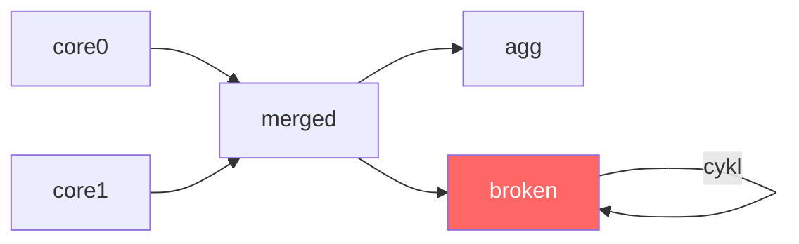

# Wykrywanie pętli w kompilacji

Graf zależności zapytań musi być acyklicznym grafem skierowanym (DAG). Jeśli zapytanie odwołuje się - bezpośrednio lub pośrednio - do własnych wyników, powstaje cykl. Kompilator wykrywa taką sytuację i kończy kompilację z błędem.

> **_NOTE:_** Opisana funkcjonalność ma pokrycie w teście: `issue95_loopInCompile` opisanym w załączniku pt. [Testy Integracyjne](../zalaczniki/testy-integracyjne.md).

## Przykład pętli

```rql
DECLARE a BYTE, b INTEGER STREAM core0, 0.1 TEXTFILE 'sensor_a.txt'
DECLARE c INTEGER, d FLOAT STREAM core1, 0.2 TEXTFILE 'sensor_b.txt'

SELECT merged[0]*10, merged[2]+10 STREAM merged FROM core0 + core1
SELECT *                          STREAM agg    FROM MAX(merged)
SELECT *                          STREAM broken FROM merged + broken
```

Ostatnie zapytanie definiuje `broken` jako wynik operacji `merged + broken` - strumień zależy od samego siebie. Graf zależności zawiera cykl (Rys. 41):



_Rys. 41. Cykl w grafie zależności zapytań_

## Efekt kompilacji

Próba kompilacji takiego pliku kończy się błędem:

```
$ xretractor brokenQuery.rql -c 2>out.txt
$ echo $?
71
$ cat out.txt
Input file:brokenQuery.rql
Check result:Circular dependency in stream definitions
```

Komunikat `"Circular dependency in stream definitions"` pojawia się, gdy etap `resolveStreamIntervals` pozostawi nierozwiązane strumienie i w całej rundzie nie rozwiąże żadnego nowego. Powyższy kod wyjścia `71` dotyczy Linuksa. Jak uruchomić kompilację i czytać komunikaty błędów - patrz [Debugowanie kompilacji](debugowanie-kompilacji.md).

## Mechanizm wykrywania

Etap `resolveStreamIntervals` w każdej rundzie zlicza strumienie oczekujące na interwał źródła (`unresolvedCount`) oraz strumienie, które właśnie uzyskały pierwszy znany interwał (`resolvedThisPass`). Gdy `unresolvedCount == 0`, etap kończy się sukcesem. W przeciwnym razie sprawdza:

```cpp
if (resolvedThisPass == 0) {
  SPDLOG_ERROR("Circular dependency: stream interval resolution stalled with {} unresolved streams", unresolvedCount);
  return {"Circular dependency in stream definitions"};
}
```

Przed tym etapem kompilator sprawdza istnienie źródeł i dodatniość interwałów deklaracji. Znany interwał pozostaje znany. Jeśli nierozwiązana część grafu jest acykliczna, istnieje w niej węzeł, którego wszystkie źródła są już rozwiązane, więc w danej rundzie zostanie rozwiązany co najmniej jeden nowy strumień. Brak takiego postępu przy niepustej części nierozwiązanej oznacza cykl. Niezależne od cyklu strumienie mogą zostać rozwiązane wcześniej.

Sortowanie w tym etapie odbywa się według interwału, a nie topologicznie. Dlatego poprawny plan może wymagać kilku rund, ale nie może utknąć bez postępu. Szczegóły i przykład kolejności odwiedzin opisuje [Rozwiązywanie interwałów](rozwiazywanie-interwalow.md).

Starszy zapis porównujący `unresolvedCount >= prevUnresolved` także wykrywa brak postępu, jeśli każdy nierozwiązany węzeł jest prawidłowo zliczany, a rozwiązane węzły pozostają rozwiązane. Aktualna implementacja sprawdza bezpośrednio liczbę nowo rozwiązanych strumieni.

## Jak naprawić

Usunąć odwołanie strumienia do samego siebie lub do strumienia, który od niego zależy. W powyższym przykładzie zapytanie:

```rql
SELECT * STREAM broken FROM merged + broken
```

należy zastąpić odwołaniem do strumienia, który istnieje niezależnie od `broken`:

```rql
SELECT * STREAM broken FROM merged + core0
```
