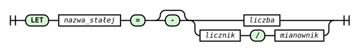

# Polecenie LET

Polecenie `LET` nadaje nazwę stałej liczbowej. Plan może potem odwoływać się do niej przez `?NAZWA` wszędzie tam, gdzie przyjmuje liczbę: w parametrach okna `@`, indeksach pól, rozmiarach, przesunięciu, interwałach, retencji, granicach `DUMP` i w wyrażeniach. Zapytanie opisuje wtedy rolę parametru (`WINDOW_WIDTH`, `ALARM_LIMIT`) zamiast powtarzać magiczne liczby, a zmiana parametru wymaga edycji jednego wiersza.

Stała nie jest zmienną: jej wartość jest ustalona w chwili wczytania planu i nie zmienia się podczas wykonania. Liczby wpisane wprost w zapytanie (literały) pozostają pełnoprawne, a obie formy mogą występować w jednym planie.

> **_NOTE:_** Opisana funkcjonalność ma pokrycie w testach: `let_constants`, `let_typed` i `adhoc_parse_error` opisanych w załączniku pt. [Testy Integracyjne](../zalaczniki/testy-integracyjne.md) oraz w testach jednostkowych kompilatora (`ut_compiler`).

## Składnia

```rql
LET nazwa_stałej = wartość
LET nazwa_stałej : TYP = wartość
```



_Rys. 67. Diagram składni polecenia LET_

Diagram składni (railroad) przedstawiony na Rys. 67 został wygenerowany na podstawie reguły `let_statement` z gramatyki ANTLR4 systemu (`RQL.g4`). Za słowem kluczowym `LET` stoi nazwa stałej, opcjonalna adnotacja typu `: TYP` (zob. [Jawny typ](#jawny-typ)), znak `=` i wartość: liczba całkowita lub dziesiętna albo ułamek `licznik/mianownik`, każda z opcjonalnym znakiem minus.

Przykład syntetyczny:

```rql
LET SIGNAL_INDEX = 0
LET STATUS_INDEX = 1
LET WINDOW_STEP = 3
LET WINDOW_WIDTH = 16
LET ALARM_LIMIT = 250

DECLARE signal INTEGER, status INTEGER STREAM sample, 1 TEXTFILE 'sample.txt'
SELECT sample[?SIGNAL_INDEX], sample[?STATUS_INDEX] STREAM channels FROM sample
SELECT * STREAM block FROM channels@(?WINDOW_STEP, ?WINDOW_WIDTH)
RULE high_signal ON channels WHEN channels[?SIGNAL_INDEX] >= ?ALARM_LIMIT DO DUMP -1 TO 1
```

Kompilacja tego planu (`xretractor -c`) daje dokładnie ten sam plan co zapis z literałami `0`, `1`, `@(3, 16)` i `>= 250`.

### Prawa strona

Prawą stroną jest zawsze **jeden literał**:

| Postać | Przykład | Uwagi |
|---|---|---|
| liczba całkowita | `LET N = 16`, `LET OFFSET = -3` | zakres 32-bitowej liczby całkowitej ze znakiem |
| liczba dziesiętna | `LET GAIN = 0.5`, `LET T = 2.` | postać jak literał zmiennoprzecinkowy RQL; zapis z wykładnikiem (`1E3`) nie jest przyjmowany |
| ułamek | `LET SOURCE_INTERVAL = 1/40` | mianownik różny od zera |

Wyrażenie (`LET A = 1 + 2`), odwołanie do innej stałej (`LET B = ?A`) i znak plus (`LET X = +1`) są błędami składni.

### Jawny typ

Adnotacja `LET NAZWA : TYP = literał` nadaje stałej typ niezależny od pisowni literału. `TYP` to `INTEGER`, `UINT`, `FLOAT`, `DOUBLE` albo `RATIONAL`, także w pisowni `Integer`, `Uint`, `Float`, `Double`, `Rational` - ta sama lista co w [VAR](polecenie-var.md). `STRING`, `BYTE` i inne typy są błędem składni. Stała bez adnotacji zachowuje się jak dotąd (zob. [Typ stałej](#typ-stałej)), a plan bez adnotacji kompiluje się do identycznego planu.

Literał deklaracji przechodzi tę samą konwersję co literał zmiennej z adnotacją (macierz w rozdziale [VAR - Jawny typ](polecenie-var.md#jawny-typ)): do `INTEGER` i `UINT` tylko dokładnie, do `RATIONAL` dokładnie z tekstu literału (`0.25` to `1/4`), do `FLOAT` i `DOUBLE` z zaokrągleniem. Literał bez wartości w danym typie jest odmową wskazującą deklarację, np. `line 1:4: value -1 of constant ?N is out of range for UINT`.

W wyrażeniu `SELECT` i `RULE ... WHEN` stała z adnotacją jest liczbą w typie z adnotacji. Pozwala to zapisać w wyrażeniu wartości, których literał nie wyraża:

```rql
LET K : DOUBLE = 0.1
LET Q : RATIONAL = 1/4
LET N : UINT = 3000000000

DECLARE x DOUBLE, k INTEGER, u UINT STREAM src, 1 TEXTFILE 'data.txt'
SELECT src[0] * ?K, src[1] * ?Q, src[2] STREAM scaled FROM src
RULE above ON scaled WHEN scaled[2] > ?N DO DUMP -1 TO 1
```

- `src[0] * ?K` mnoży przez `0.1` w precyzji `DOUBLE`. Stała `LET C = 0.1` bez adnotacji jest w wyrażeniu wartością `FLOAT` (0.100000001490116...), a `to_double(?C)` tego nie naprawia, bo argument jest już `FLOAT`.
- `src[1] * ?Q` daje pole `RATIONAL` (dla `k = 3` wartość `3/4`). Bez adnotacji ułamek w wyrażeniu jest odmową, a zapis `1/4` - dzieleniem całkowitym.
- `scaled[2] > ?N` porównuje dwie wartości `UINT`. Liczby 3000000000 nie da się zapisać literałem całkowitym w wyrażeniu.

Typ pola `SELECT` wynika z typów operandów tak jak dla pól i literałów: `DOUBLE * FLOAT` daje `DOUBLE`, `INTEGER * RATIONAL` - `RATIONAL`, `UINT + INTEGER` - `UINT`.

`-?NAZWA` neguje wartość w typie z adnotacji. Negacja bez wartości w tym typie jest odmową: przy `LET N : UINT = 5` zapis `-?N` daje `expression -?N = 5 (line 3:8) is out of range for UINT`.

Po prawej stronie `DO SET` stała z adnotacją zachowuje się jak każda stała: jeśli jest całą prawą stroną, jej tekst jest konwertowany do typu **zmiennej** (zob. [VAR](polecenie-var.md)), a adnotacja stałej nie ma znaczenia. Przy `LET K : DOUBLE = 0.1` i `VAR R : RATIONAL = 0` zapis `DO SET ?R = ?K` ustawia dokładnie `1/10`. Każda inna prawa strona ze stałą typowaną ma typ wynikający z typów operandów, jak każde wyrażenie.

W kontekstach strukturalnych (indeksy, rozmiary, `@`, `>`, okna, retencja, `DUMP`, interwały, `TIMEOUT`) stała z adnotacją jest dopuszczalna tylko z typem naturalnym dla kontekstu: `INTEGER` w kontekstach całkowitych, `INTEGER` albo `RATIONAL` w interwale `DECLARE`, w operatorach `&`, `%`, `-` i w `TIMEOUT`. Kontekst bierze wtedy wartość po konwersji: `LET W : INTEGER = 4/2` w `src > ?W` daje to samo co `src > 2`, a `LET T : RATIONAL = 0.0000001` jako interwał to dokładnie `1/10000000`. Każda inna adnotacja jest odmową, a nie cichą konwersją: kto pisze `LET W : DOUBLE = 3`, zadeklarował wartość `DOUBLE`, a przesunięcie wymaga liczby całkowitej - `line 3:27: constant ?W : DOUBLE cannot be used in time shift; it takes a constant without annotation or annotated INTEGER`.

### Nazwa i odwołanie

Nazwa stałej zaczyna się od litery i składa się z liter, cyfr i podkreślników. Znak `$` jest niedozwolony, aby odwołania nie myliły się z indeksem generatora strumieni. Wielkość liter ma znaczenie: `?signal` i `?SIGNAL` to różne stałe.

Odwołanie to jeden token: znak `?` i bezpośrednio po nim nazwa, bez spacji (`? NAZWA` jest błędem leksera). Stałe mają **osobną przestrzeń nazw**: `?X` nigdy nie jest polem ani strumieniem, a goły identyfikator `X` nigdy nie jest stałą. Stała może więc nosić tę samą nazwę co pole, strumień lub funkcja bez kolizji, a istniejące zapytania nie zmieniają znaczenia. `?` wewnątrz napisu, ścieżki, komentarza i polecenia `SYSTEM` pozostaje zwykłym tekstem.

Słowo `LET` (także `let`) jest zastrzeżone i nie może być nazwą strumienia, pola ani reguły.

### Zasięg

- Stała obowiązuje od wiersza deklaracji do końca pliku planu. `LET` może stać w dowolnym miejscu pliku, ale przed pierwszym użyciem; odwołanie przed deklaracją jest błędem.
- Ponowna deklaracja tej samej nazwy jest błędem, także przy kolizji z [VAR](polecenie-var.md). `LET` i `VAR` dzielą przestrzeń nazw; stałej nie da się nadpisać ani użyć jako celu `DO SET`.
- Stałe należą do jednego planu: nie przechodzą do innego pliku, kolejnego wczytania ani zapytań ad hoc.
- Nieużyta stała nie jest błędem. `xretractor` wypisuje ostrzeżenie na stderr, także z `--quiet`, np. `xretractor: warning: line 2: constant ?UNUSED is declared but never used`. Przy ponownym wczytaniu planu przez kanał reset to samo ostrzeżenie trafia do dziennika serwera.

## Gdzie można użyć stałej

`?NAZWA` może stanąć wszędzie tam, gdzie gramatyka przyjmuje literał liczbowy. W każdym miejscu podlega tym samym ograniczeniom co literał (zakres, znak, granice planu z rozdziału [Granice wymiarów planu](../kompilacja-zapytan/granice-wymiarow-planu.md)).

| Miejsce | Zapis ze stałą | Wymagana wartość |
|---|---|---|
| parametry okna `@` | `src@(?WINDOW_STEP, ?WINDOW_WIDTH)`, `src@(?STEP, -?WIDTH)` | całkowita; krok > 0, szerokość różna od zera (ujemna jak w literale) |
| indeks pola | `src[?FIELD_INDEX]` | całkowita, ≥ 0 |
| rozmiar pola tablicowego | `INTEGER[?CHANNEL_COUNT]`, `STRING[?TEXT_WIDTH]` | całkowita, > 0 |
| rozmiar rodziny strumieni | `STREAM result[?FAMILY_SIZE]` | całkowita, > 0 |
| indeks generatora | `src[?LAST_INDEX-$]` | całkowita; arytmetyka indeksu jak dla literału |
| przesunięcie | `src > ?SHIFT` | całkowita, ≥ 0 |
| okno rekordowe | `AVG(src[?FIELD_INDEX] : ?HISTORY_WIDTH)` | całkowita, > 0 |
| szerokość tekstu | `to_string(x : ?TEXT_WIDTH)` | całkowita, > 0 |
| retencja | `RETENTION ?CAPACITY ?SEGMENTS` | całkowite; pojemność > 0, segmenty ≥ 0 |
| `DUMP` | `DUMP -?BEFORE TO ?AFTER RETENTION ?KEEP` | całkowite; granice jak w literale, retencja ≥ 0 |
| interwał `DECLARE` | `STREAM src, ?SOURCE_INTERVAL TEXTFILE '...'` | > 0 |
| operatory `&`, `%`, `-` | `src - ?OUTPUT_INTERVAL` | > 0 |
| `TIMEOUT` | `TIMEOUT ?WAIT` | ≥ 0 |
| wyrażenie w `SELECT` i `RULE ... WHEN` | `src[0] * ?GAIN + ?OFFSET`, `x >= ?ALARM_LIMIT` | całkowita lub dziesiętna; z adnotacją także `UINT`, `DOUBLE` i `RATIONAL` |

Na diagramach składni poleceń [SELECT](polecenie-select/), [DECLARE](polecenie-declare.md) i [RULE](polecenie-rule.md) gałąź `?stała` stoi obok liczby wszędzie tam, gdzie diagram pokazuje liczbę: przy rozmiarach, interwałach, `TIMEOUT`, retencji i granicach `DUMP`. Pozostałe miejsca z tabeli należą do wyrażeń, których diagramy nie rozpisują.

Przykład obejmujący wszystkie konteksty jednocześnie:

```rql
LET SOURCE_INTERVAL = 1/40
LET TEXT_WIDTH = 8
LET FAMILY_SIZE = 2
LET LAST_INDEX = 1
LET VALUE_INDEX = 0
LET HISTORY_WIDTH = 4
LET SHIFT = 2
LET OUTPUT_INTERVAL = 1/20
LET GAIN = 0.5
LET OFFSET = -3
LET CAPACITY = 1000
LET SEGMENTS = 2

DECLARE value INTEGER, label STRING[?TEXT_WIDTH] STREAM src, ?SOURCE_INTERVAL TEXTFILE 'wide.txt'
SELECT src[?LAST_INDEX-$] STREAM fam[?FAMILY_SIZE] FROM src
SELECT AVG(src[?VALUE_INDEX] : ?HISTORY_WIDTH) STREAM avg_value FROM src
SELECT to_string(src[?VALUE_INDEX] : ?TEXT_WIDTH) STREAM text FROM src > ?SHIFT
SELECT src[?VALUE_INDEX] * ?GAIN + ?OFFSET STREAM scaled FROM src - ?OUTPUT_INTERVAL RETENTION ?CAPACITY ?SEGMENTS
```

## Typ stałej

Stała bez adnotacji ma typ swojego literału. W każdym miejscu parser zamienia ją tak samo, jak zamieniłby literał tej postaci wpisany w to miejsce, bez niejawnej konwersji:

| Kontekst | stała całkowita | stała dziesiętna | ułamek |
|---|---|---|---|
| konteksty całkowite (indeksy, rozmiary, `@`, `>`, okna, retencja, `DUMP`) | wartość | odmowa: `is not an integer` | odmowa: `is not an integer` |
| interwał `DECLARE`, `&`, `%`, `-`, `TIMEOUT` | `n` jak literał `n` | jak literał `x.y` (zamiana na ułamek z tą samą kontrolą zakresu) | jak literał `a/b` |
| wyrażenie w `SELECT` i `RULE ... WHEN` | `INTEGER` | `FLOAT` | odmowa: w wyrażeniu `1/40` jest dzieleniem całkowitym, a nie literałem ułamka - zapisz stałą dziesiętnie |

Stała z adnotacją ma typ z adnotacji - zob. [Jawny typ](#jawny-typ).

Ułamek złożony ze stałej, np. `?N/40` lub `?A/?B`, nie jest literałem ułamka. W interwale jest błędem składni, a w wyrażeniu - zwykłym dzieleniem wartości stałej przez `40`.

### Znak minus

Tam, gdzie literał przyjmuje znak minus (szerokość okna `@`, granice `DUMP`, `TIMEOUT`, wyrażenia), można napisać `-?X`. Zapis neguje wartość stałej, a wynik podlega tym samym ograniczeniom co literał. Przy `LET W = 3` zapis `src@(1, -?W)` daje to samo co `src@(1, -3)`, a przy `LET W = -3` zapis `src@(1, ?W)` daje ten sam wynik. W wyrażeniu `-?X` jest jednym czynnikiem, jak literał `-2`: `-?X^2` oznacza `(-X)^2`. W `TIMEOUT` ujemny wynik jest odmową: `TIMEOUT -?W` przy `W = 1` daje `DECLARE dev: TIMEOUT ?W = 1 (...) must not be negative`, a `-?Z` przy `Z = 0` jest przyjmowane.

## Stała znika przed wykonaniem

Stałe rozwiązuje wyłącznie parser: do kompilatora trafiają już liczby. Deklaracja `LET` nie tworzy strumienia, pola, węzła planu ani operacji wykonywanej dla każdego rekordu, a nazwy nie są wyszukiwane w trakcie przetwarzania.

Skutki:

- plan z `LET` i ten sam plan z literałami dają identyczny wynik kompilacji: programy, schematy, typy, interwały, wymagania historii i retencji;
- wydruki `xretractor -c` (tekst, CSV i graf DOT) pokazują liczby, nie nazwy stałych - nazwy występują tylko w komunikatach parsera;
- optymalizacje planu działają na liczbach, jak dla literałów.

## Zapytania ad hoc

Zapytanie ad hoc (`xqry`) nie widzi stałych działającego planu. Zapytanie z deklaracją `LET` jest odrzucane (`'LET' is not supported`), a odwołanie `?X` kończy się błędem nieznanej stałej. Odmowa nie zmienia działającego planu i nie zatrzymuje serwera.

## Błędy

Każdy błąd stałej jest odmową kompilacji: `xretractor` kończy pracę z kodem błędu, a serwer odrzuca zapytanie bez zmiany planu. Komunikat podaje nazwę stałej, kontekst i pozycję `wiersz:kolumna` w pliku planu.

| Sytuacja | Przykład komunikatu |
|---|---|
| nieznana stała lub użycie przed deklaracją | `line 2:14: constant ?NOPE in field index is not declared; LET must precede its first use` |
| ponowna deklaracja | `line 3:4: constant ?A is already declared on line 2` |
| `$` w nazwie | `line 2:4: constant name A$B must not contain '$'` |
| zerowy mianownik | `line 2:4: fraction 1/0 of constant ?D has a zero denominator` |
| wartość poza zakresem literału | `line 2:4: value 2147483648 of constant ?X is out of range` |
| wartość niecałkowita w kontekście całkowitym | `line 3:14: constant ?H = 0.5 in field index is not an integer` |
| ułamek w wyrażeniu (bez adnotacji; z `: RATIONAL` jest przyjmowany) | `constant ?F = 1/40 (line 3:19) is a fraction, which an expression has no literal for; write it as a decimal` |
| literał bez wartości w typie z adnotacji | `line 1:4: value 2.5 of constant ?N is out of range for INTEGER` |
| negacja bez wartości w typie z adnotacji | `expression -?N = 5 (line 3:8) is out of range for UINT` |
| adnotacja niedopuszczalna w kontekście strukturalnym | `line 3:9: constant ?N : UINT cannot be used in field index; it takes a constant without annotation or annotated INTEGER` |
| naruszenie ograniczenia miejsca | `AGSE window ?W = 0 (line 3:34) must be greater than zero`, `interval ?N = -1 (line 3:29) must be greater than zero`, `DUMP RETENTION ?B = -2 (line 4:52) must not be negative` |
| wyrażenie lub odwołanie po prawej stronie, spacja po `?`, typ spoza listy (`BYTE`, `STRING`) | błąd składni parsera, np. `token recognition error at: '? '` |

Ograniczenia miejsca, których nie da się sprawdzić w chwili podstawienia - np. indeks poza schematem strumienia czy pusty zakres `DUMP` - zgłasza kompilator tym samym komunikatem co dla literału.

## Pomiary i porównania

Narzędzia porównujące różne wersje silnika na tym samym tekście planu wymagają, aby każda porównywana wersja umiała ten plan wczytać. Wersje sprzed wprowadzenia `LET` odrzucają plan ze stałymi, dlatego do takich porównań należy używać planów z literałami, a warianty z `LET` trzymać w osobnych plikach.
