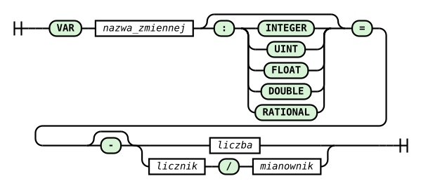

# Polecenie VAR i akcja DO SET

`VAR` deklaruje zmienną liczbową wspólną dla całego planu. Odczyt `?NAZWA` pobiera jej bieżącą wartość, a reguła `RULE ... DO SET` zleca zmianę. Zmienna pozwala zapamiętać stan między rekordami: zatrzask alarmu, licznik od początku pracy albo średnią wykładniczą. Nie tworzy strumienia, pola ani węzła drzewa zapytań.

W odróżnieniu od [stałej LET](polecenie-let.md), podstawianej przez parser, `VAR` pozostaje częścią stanu wykonania. Ten sam znacznik `?` oznacza stałą albo zmienną zależnie od deklaracji.

## Składnia, nazwy i typy

```text
VAR NAZWA = literał
VAR NAZWA : TYP = literał
RULE nazwa_reguły ON strumień WHEN warunek DO SET ?NAZWA = wyrażenie
```



Diagram jest generowany z reguły `var_statement` gramatyki `RQL.g4`. Prawą stroną deklaracji jest jeden literał, z opcjonalnym minusem. Bez [jawnego typu](#jawny-typ) typ zmiennej wynika z pisowni literału:

| Deklaracja | Typ zmiennej | Uwagi |
|---|---|---|
| `VAR COUNT = 0` | `INTEGER` | 32-bitowa liczba całkowita ze znakiem |
| `VAR GAIN = 0.5` | `FLOAT` | 32-bitowa liczba zmiennoprzecinkowa, także przy zapisie `0.0` |
| `VAR RATIO = 1/3` | `RATIONAL` | ułamek z niezerowym mianownikiem |

Napisy, `NULL` jako literał inicjalizujący, wyrażenia (`VAR X = 1 + 2`), odwołania (`VAR X = ?Y`), znak plus i zapis wykładniczy nie są przyjmowane. Wartość musi mieścić się w zakresie literału danego typu.

Nazwa zaczyna się od litery, dalej zawiera litery, cyfry i podkreślniki. Wielkość liter ma znaczenie; `$` jest niedozwolony. W odwołaniu nie ma spacji po `?`. Deklaracja musi poprzedzać pierwsze użycie. `LET` i `VAR` mają jedną przestrzeń nazw: nie można zadeklarować tej samej nazwy ponownie, także zmieniając rodzaj deklaracji. Ta przestrzeń jest odrębna od nazw pól i strumieni. `VAR`, `var`, `SET` i `set` są słowami zastrzeżonymi, podobnie jak nazwy typów, w tym `RATIONAL` i `Rational`.

### Jawny typ

Adnotacja `VAR NAZWA : TYP = literał` ustala typ zmiennej niezależnie od pisowni literału. `TYP` to `INTEGER`, `UINT`, `FLOAT`, `DOUBLE` albo `RATIONAL`, także w pisowni `Integer`, `Uint`, `Float`, `Double`, `Rational`. Tylko w ten sposób można zadeklarować zmienną `UINT` albo `DOUBLE`, bo te typy nie mają własnej postaci literału. W pozostałych przypadkach adnotacja zapisuje intencję w planie: `VAR SUMA : FLOAT = 0` zamiast `VAR SUMA = 0.0`. `STRING`, `BYTE` i inne typy są błędem składni. Tę samą adnotację przyjmuje stała [LET](polecenie-let.md#jawny-typ).

Literał deklaracji jest konwertowany do wskazanego typu. Do `INTEGER` i `UINT` konwersja musi być dokładna. Do `RATIONAL` wartość jest liczona dokładnie z tekstu literału i skracana, więc `0.25` daje `1/4`. Do `FLOAT` i `DOUBLE` wartość jest zaokrąglana tak jak literał dziesiętny w wyrażeniu. Literał, który nie ma wartości w danym typie, kończy kompilację odmową z nazwą, typem i pozycją, np. `line 1:4: value -1 of variable ?N is out of range for UINT`.

| Literał \ typ | `INTEGER` | `UINT` | `FLOAT` | `DOUBLE` | `RATIONAL` |
|---|---|---|---|---|---|
| `10` | 10 | 10 | 10.0 | 10.0 | 10/1 |
| `-1` | -1 | odmowa | -1.0 | -1.0 | -1/1 |
| `2.5` | odmowa | odmowa | 2.5 | 2.5 | 5/2 |
| `2.0`, `4/2` | 2 | 2 | 2.0 | 2.0 | 2/1 |
| `1/3` | odmowa | odmowa | zaokrąglone | zaokrąglone | 1/3 |
| `3000000000` | odmowa | 3000000000 | 3000000000.0 | 3000000000.0 | odmowa |
| `0.123456789012` | odmowa | odmowa | zaokrąglone | zaokrąglone | odmowa |

`RATIONAL` przechowuje licznik i mianownik jako 32-bitowe liczby całkowite ze znakiem. Dlatego `3000000000` i `0.123456789012`, którego mianownik po skróceniu przekracza ten zakres, nie mają wartości w tym typie. `UINT` przyjmuje literały od 0 do 4294967295.

Poniższy plan czyta `signal.txt`, w którym każdy wiersz zawiera próbkę `DOUBLE` i znacznik całkowity:

```rql
VAR COUNT : UINT = 0
VAR TOTAL : DOUBLE = 0
VAR LIMIT : RATIONAL = 0.25

DECLARE x DOUBLE, k INTEGER STREAM src, 1 TEXTFILE 'signal.txt'
SELECT src[0], src[1], ?COUNT, ?TOTAL, ?LIMIT STREAM totals FROM src
RULE count ON totals WHEN totals[0] > ?LIMIT DO SET ?COUNT = ?COUNT + 1
RULE acc ON totals WHEN 1 = 1 DO SET ?TOTAL = ?TOTAL + totals[0]
RULE raise ON totals WHEN totals[1] > 0 DO SET ?LIMIT = ?LIMIT * 2
RULE clear ON totals WHEN totals[1] < 0 DO SET ?COUNT = 0
RULE restore ON totals WHEN totals[1] < 0 DO SET ?LIMIT = 0.1
```

`TOTAL` sumuje pole `DOUBLE` bez zawężania do `FLOAT`. Bez adnotacji akumulator wymagałby `to_float(...)` w każdym `SET` i traciłby precyzję. `COUNT` jest zerowany literałem `0`, a `LIMIT` wraca do dokładnie `1/10`. Oba zapisy działają dzięki [konwersji literału w `SET`](#typowanie-i-null). Plan bez adnotacji liczy to samo co przed jej wprowadzeniem.

Nieużyta zmienna powoduje ostrzeżenie `declared but never used`, także przy `--quiet`; samo użycie jej jako celu `SET` wystarcza, aby była uznana za użytą.

## Dozwolone konteksty

| Miejsce | Odczyt VAR |
|---|---|
| wyrażenie skalarne listy `SELECT` | tak, np. `src[0] * ?GAIN` |
| warunek `RULE ... WHEN` | tak, np. `?ALARM = 0` |
| prawa strona `DO SET` | tak, np. `?COUNT + 1` |
| indeksy pól i generatora, rozmiary pól i rodzin strumieni | odmowa |
| parametry `@`, przesunięcie `>`, interwały, operatory `&`, `%` i `-` na strumieniach | odmowa |
| szerokość okna rekordowego, szerokość `to_string`, `TIMEOUT`, `RETENTION`, granice `DUMP` | odmowa |
| argument agregacji po oknie rekordowym, np. `AVG(src[0] * ?GAIN : 4)` | odmowa |

Wartości strukturalne ustalają kształt planu i czas przetwarzania; można tam używać literałów albo `LET`. VAR w argumencie okna rekordowego jest odrzucana, ponieważ historyczny rekord nie niesie historycznej wartości zmiennej. Aby najpierw utrwalić przeskalowane wartości, utwórz osobny strumień `SELECT`, a okno oblicz nad jego polami.

Warunek i prawa strona `SET` korzystają z bieżącego rekordu strumienia wskazanego przez `ON`, stałych `LET` i zmiennych planu. Odwołanie do pola innego strumienia, reduktor strumieniowy albo okno rekordowe w `SET` są odrzucane; potrzebne dane należy wcześniej obliczyć w `SELECT`. Cel `ON` musi być strumieniem utworzonym przez `SELECT`. Reguła `SET` na całej rodzinie generatora jest odrzucana: jej kopie pisałyby jedną zmienną z tym samym pierwszeństwem. VAR jest wspólna dla planu, a stan osobny dla kanałów wymaga osobnych deklaracji i reguł.

## Zapis widoczny od następnego slotu

Slot to jedna chwila siatki czasowej, w której silnik oblicza wszystkie należne strumienie. Wszystkie wyrażenia `SELECT`, warunki i prawe strony `SET` w tym slocie czytają **wartości zmiennych sprzed slotu**. Zapis trafia do bufora, a silnik zatwierdza go dopiero na końcu udanego slotu, po przesunięciu źródeł. Czytelnicy widzą go od następnego slotu, niezależnie od swojej pozycji w planie.

Na strumieniu o innym interwale zmiana będzie widoczna przy jego następnym należnym rekordzie. Slot nie jest stałym opóźnieniem w sekundach. Przy jednym strumieniu próbkowanym co sekundę jest to opóźnienie o jedną próbkę. Slot przerwany błędem nie zatwierdza zapisów zmiennych; nie oznacza to wycofania zapisanych już rekordów ani efektów `DUMP` lub `SYSTEM`.

### Histereza

Poniższy kompletny plan czyta `signal.txt` (jedna liczba całkowita na wiersz):

```rql
LET ALARM_ON = 250
LET ALARM_OFF = 200
VAR ALARM = 0

DECLARE x INTEGER STREAM src, 1 TEXTFILE 'signal.txt'
SELECT src[0], ?ALARM STREAM status FROM src
RULE alarm_on ON status WHEN status[0] >= ?ALARM_ON DO SET ?ALARM = 1
RULE alarm_off ON status WHEN status[0] < ?ALARM_OFF DO SET ?ALARM = 0
```

| Slot | Wejście | `status[1]`: stan zapisany w rekordzie | ALARM po slocie |
|---|---|---|---|
| 0 | 220 | 0 | 0 |
| 1 | 260 | 0 | 1 |
| 2 | 220 | 1 | 1 |
| 3 | 190 | 1 | 0 |
| 4 | 220 | 0 | 0 |

Przekroczenie 250 w slocie 1 ustawia zmienną po obliczeniu rekordu. Dlatego pole alarmu jest równe 1 dopiero w slocie 2. Między progami stan pozostaje zapamiętany. Reguła sprawdzająca bezpośrednio próbkę może wykonać `DUMP` w slocie przekroczenia; reguła sprawdzająca dopiero zmienną zobaczy zmianę w następnym slocie.

### Licznik i średnia wykładnicza

```rql
VAR COUNT = 0
VAR E = 0.0

DECLARE x INTEGER STREAM src, 1 TEXTFILE 'signal.txt'
SELECT src[0], ?COUNT, ?E STREAM history FROM src
RULE count ON history WHEN history[0] > 100 DO SET ?COUNT = ?COUNT + 1
RULE ema ON history WHEN 1 = 1 DO SET ?E = ?E * 0.5 + history[0] * 0.5
```

Dla pierwszych trzech próbek równych 200:

| Slot | COUNT w rekordzie | E w rekordzie | COUNT po slocie | E po slocie |
|---|---|---|---|---|
| 0 | 0 | 0.0 | 1 | 100.0 |
| 1 | 1 | 100.0 | 2 | 150.0 |
| 2 | 2 | 150.0 | 3 | 175.0 |

Rekord pokazuje licznik i EMA obliczone z wcześniejszych próbek. Jest to opóźnienie o slot, jak rejestr `z^-1`. Początkowe `E = 0.0` i 32-bitowa arytmetyka `FLOAT` są częścią tego przykładu.

## Konflikty zapisów

Jeśli kilka reguł zapisuje tę samą zmienną w jednym slocie, wygrywa **ostatnia wyzwolona reguła w kolejności tekstowej planu**, także gdy reguły dotyczą różnych strumieni. Nie rozstrzyga kolejność wykonania węzłów, ich interwał ani pozycja instrukcji `SELECT`. Reguła z fałszywym warunkiem nie bierze udziału w konflikcie.

Wszystkie prawe strony czytają tę samą starą wartość: dwie wyzwolone reguły `SET ?COUNT = ?COUNT + 1` dają łącznie przyrost o 1, a nie o 2. Jedna reguła ma jedną akcję (`SET`, `DUMP` albo `SYSTEM`); kilka akcji wymaga kilku reguł z takim samym warunkiem.

### uc10: chłodnia i licznik cykli sprężarki

Przykład pochodzi z publicznego [szkicu uc10](https://github.com/michalwidera/retractordb/issues/531#issuecomment-6254884794). Temperatura w `temp.txt` jest podawana co sekundę w dziesiątych częściach stopnia. `hour.txt` zawiera po jednej liczbie całkowitej na takt godzinny. Sprężarka włącza się przy 5,0 stopnia i wyłącza przy 2,0; więcej niż 6 cykli wyzwala zrzut historii.

```rql
LET T_ON = 50
LET T_OFF = 20
LET MAX_CYCLES = 6
VAR COMP = 0
VAR CYCLES = 0

DECLARE t INTEGER STREAM temp, 1 TEXTFILE 'temp.txt'
DECLARE k INTEGER STREAM hour, 3600 TEXTFILE 'hour.txt'
SELECT temp[0], ?COMP, ?CYCLES STREAM status FROM temp
SELECT hour[0] STREAM hour_tick FROM hour
RULE cycle ON status WHEN status[0] >= ?T_ON AND ?COMP = 0 DO SET ?CYCLES = ?CYCLES + 1
RULE comp_on ON status WHEN status[0] >= ?T_ON DO SET ?COMP = 1
RULE comp_off ON status WHEN status[0] <= ?T_OFF DO SET ?COMP = 0
RULE hour_reset ON hour_tick WHEN 1 = 1 DO SET ?CYCLES = 0
RULE short_cycling ON status WHEN ?CYCLES > ?MAX_CYCLES DO DUMP -60 TO 0
```

Reguła `cycle` wykrywa zbocze: w slocie włączenia `COMP` nadal ma wartość 0, choć `comp_on` zleca już zapis 1. Gdy `cycle` i `hour_reset` wyzwolą się razem, późniejsza w tekście `hour_reset` ustala `CYCLES = 0`. Cykl rozpoczęty dokładnie w tym slocie nie zostaje doliczony do nowej godziny. Dotyczy to również początkowego slotu wspólnego dla obu strumieni; wolny strumień nie czeka godziny na swój pierwszy rekord.

`short_cycling` również czyta stan sprzed slotu: siódmy cykl jest widoczny w warunku od następnego slotu. Zrzut `-60 TO 0` obejmuje 60 wcześniejszych rekordów i nie obejmuje rekordu wyzwalającego. Przykład pokazuje stan planu; nie wysyła polecenia do fizycznej sprężarki.

Zapisz wybrany kompletny plan w osobnym pliku i sprawdź go poleceniem `xretractor -c plan.rql`. Kompilacja nie wymaga istnienia źródeł; wykonanie wymaga wskazanych plików i katalogu wyników. Przykłady są syntetyczne i nie pochodzą z korpusu uc01-uc08 używanego w pracy DEBS.

## Typowanie i NULL

Typ zmiennej jest ustalony raz w deklaracji: przez [adnotację](#jawny-typ) albo, bez niej, przez literał. Wyrażenie po prawej stronie `SET` musi mieć dokładnie ten typ; niejawnej konwersji nie ma. Przy `VAR X = 0` zapis `SET ?X = ?X + 0.5` to odmowa kompilacji; podobnie zapis `DOUBLE` do zmiennej `FLOAT`. Użyj jawnej konwersji, np. `to_integer(...)`, `to_float(...)` lub `to_double(...)`, albo zadeklaruj zmienną w typie wyrażenia. Gdy wyrażenie ma typ `INTEGER`, `UINT`, `FLOAT`, `DOUBLE` albo `RATIONAL`, komunikat odmowy podpowiada taką deklarację: `... use an explicit conversion function or declare VAR X : FLOAT = ...`.

Wyjątkiem jest prawa strona `SET` złożona z jednego literału, także ujemnego, albo jednej stałej `LET`. Parser konwertuje ją do typu zmiennej tak samo jak literał deklaracji z adnotacją, licząc z tekstu literału. `SET ?COUNT = 0` zeruje zmienną `UINT`, `SET ?E = 0` zmienną `FLOAT`, a `SET ?LIMIT = 0.1` zapisuje w zmiennej `RATIONAL` dokładnie `1/10`. Literał bez wartości w typie zmiennej jest odmową z celem, typem i pozycją, np. `value -1 in DO SET ?COUNT is out of range for UINT`; tak samo `SET ?X = 0.5` przy `VAR X = 0`. Nawias i ułamek tworzą już wyrażenie. `(0)` ma typ `INTEGER`, a `1/4` jest dzieleniem całkowitym o typie `INTEGER`, więc oba zapisy są odmową dla zmiennej `UINT` i `RATIONAL`, a `1/4` w zmiennej `INTEGER` daje 0. Ułamek zapisuje się do zmiennej `RATIONAL` jako literał dziesiętny `0.25` albo przez stałą: `LET Q = 1/4` i `SET ?LIMIT = ?Q`. Ułamkowa stała `LET` jest odmową w wyrażeniu, ale jako cała prawa strona `SET` jest przyjmowana.

Wynik NULL, także z dzielenia przez zero, przepełnienia albo odczytu brakującego pola, **zastępuje poprzednią wartość**. Typ deklaracji pozostaje bez zmian. NULL propaguje się w kolejnych wyrażeniach; `?X * 0` z NULL nadal daje NULL. Można sprawdzić go przez `isnull(?X)` i zapisać poprawną wartość regułą. Samo `?X = 0` nie wykrywa NULL; warunek, który daje NULL, nie wyzwala akcji.

## Cykl życia i restart

Wartości zaczynają od literałów deklaracji przy pierwszym wczytaniu planu, jego ponownym wczytaniu, zaakceptowanym `xqry --reset` i restarcie usługi. Także ponowne wczytanie identycznego tekstu zeruje pamiętany stan do wartości z deklaracji. VAR nie jest zapisywana w artefaktach ani odtwarzana z nich. Odrzucone ad hoc lub reset nie zmieniają wartości i reguł działającego planu; przyjęte ad hoc zachowuje wartości istniejących zmiennych.

**Zmiana kontraktu: utrata samonaprawy po restarcie.** Plan bez VAR, oparty na skończonej historii wejść, może odtworzyć wynik po ponownym zgromadzeniu wymaganych okien i ogona rozruchowego. Stan VAR może zależeć od zdarzenia dowolnie odległego w przeszłości, więc samo odczekanie `startupLatency` go nie odtworzy. W przykładzie histerezy alarm ustawiony na 1 po restarcie wraca do 0. Jeśli kolejne próbki pozostaną w paśmie 200-249, stan sprzed restartu nie wróci; potrzebne jest nowe przekroczenie progu włączenia albo odtworzenie właściwej historii od początku.

Powrót do stanu z deklaracji jest przyjętym zachowaniem po przerwie monitorowania: silnik nie zakłada, co zaszło podczas utraty sygnałów. Nie ma obecnie opcji trwałości VAR w `config.toml`; ewentualny tryb opt-in jest osobnym tematem [#543](https://github.com/michalwidera/retractordb/issues/543).

## Ad hoc i monitoring

[Kanał ad hoc](../realizacja-zapytan/zapytania-ad-hoc.md) pozwala czytać VAR aktywnego planu w `SELECT` i `WHEN` oraz dołączać reguły `DO SET`. Nie pozwala deklarować `VAR` ani `LET` i nie widzi stałych `LET` pliku planu. Reguła dołączona ad hoc zaczyna oceniać warunek od następnego nowego rekordu celu; jej zapis obowiązuje od slotu po wyzwoleniu. W konflikcie wygrywa z regułami planu i wcześniej dołączonymi regułami ad hoc. Po wymianie planu reguły ad hoc znikają wraz ze starą epoką.

[`xqry --vars` (`-v`)](../zalaczniki/opcje-wywolania/xqry.md#zmienne-planu---vars) pokazuje spójny obraz zatwierdzonych wartości między slotami, w kolejności deklaracji. Z `--yaml` zwraca listę `variables`; `--jsonl` jest odrzucane. To odczyt: bezpośrednie polecenie przypisania wartości przez `xqry` nie istnieje. Zmianę może zlecić reguła `DO SET`, także dołączona ad hoc. Stan pokazany między slotami może już zawierać zapis, którego nie ma jeszcze w polu zmiennej ostatniego rekordu `SELECT`.

## Pokrycie w testach

Kontrakt sprawdzają `ut_compiler`, `ut_expeval`, `ut_expressionShape`, `ut_exprSimplify` i `ut_dataModel` oraz integracje `it_var_read-run`, `it_var_set-value`, `it_var_reset-run`, `it_var_adhoc-run`, `it_var_xqry-run` i `it_var_typed-value`. `var_typed` sprawdza zmienne z adnotacją `UINT`, `DOUBLE` i `RATIONAL` wobec wyroczni Pythona, wraz z typami w `xqry --vars`. `var_set` porównuje histerezę, licznik, EMA i przeskalowane uc10/uc11/uc12/uc14 z niezależną wyrocznią Pythona liczoną od początku przebiegu. `var_reset` pokazuje utratę zatrzasku po ponownym wczytaniu. Jest to zakres opisany w [katalogu testów](../zalaczniki/testy-integracyjne.md), a nie deklaracja trwałości lub sterowania urządzeniami.
