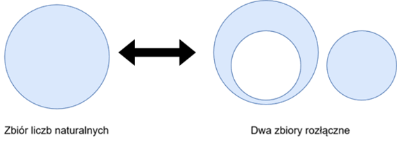

# Podstawy matematyczne

Podstawą operatorów przeplotu i rozplątania jest podział pozycji próbek na dwa rozłączne, uporządkowane zbiory. Sekwencje Beatty'ego i twierdzenie Fraenkela pozwalają opisać taki podział oraz wyprowadzić dokładne odwzorowania indeksów. Ta strona przedstawia twierdzenia źródłowe; kolejne rozdziały definiują operatory i pokazują ich zastosowanie w systemie.

Samuel Beatty w 1926 roku opublikował następujące twierdzenie [\[1\]](../literatura.md#1):

Jeśli p, q są dodatnimi liczbami niewymiernymi i zachodzi pomiędzy nimi zależność

\\[
\frac{1}{p}+\frac{1}{q}=1
\\]

to sekwencje

\\[
\left\\{
\left\lfloor np\right\rfloor \right\\} _{n=1}^{\infty }=\left\lfloor
p\right\rfloor ,\left\lfloor 2p\right\rfloor ,\left\lfloor 3p\right\rfloor
,\ldots
\\]

oraz

\\[
\left\\{ \left\lfloor nq\right\rfloor \right\\}
_{n=1}^{\infty }=\left\lfloor q\right\rfloor ,\left\lfloor 2q\right\rfloor
,\left\lfloor 3q\right\rfloor ,\ldots
\\]

dokonują podziału zbioru dodatnich liczb całkowitych.

<figure><figcaption>
Rys. 1. Reprezentacja graficzna pojęcia zbiorów rozłącznych
</figcaption></figure>

Każda dodatnia liczba całkowita należy zatem do dokładnie jednej z tych sekwencji (Rys. 1). Warunek wiążący p i q zapewnia zarówno rozłączność, jak i pełne pokrycie zbioru.

Bezpośrednie obliczanie tych pozycji za pomocą przybliżeń zmiennoprzecinkowych wymaga ostrożności: niewielki błąd w pobliżu liczby całkowitej może zmienić wynik podłogi lub sufitu, a przez to wybrać inną próbkę. Dla RetractorDB istotny jest wariant, w którym interwały i odwzorowania indeksów można obliczać dokładnie na liczbach wymiernych.

Taką możliwość daje uogólnienie przedstawione przez Aviezriego S. Fraenkela w 1969 roku [\[2\]](../literatura.md#2). Punktem wyjścia jest sparametryzowana sekwencja Beatty:

\\[
\mathcal{B}(\alpha ,\alpha ^{\prime }):=
\left( \left\lfloor \frac{n-\alpha^{\prime }}{\alpha }\right\rfloor \right) _{n=1}^{\infty }
\\]

Ta jedna definicja generuje całą rodzinę sekwencji. Twierdzenie dotyczy zawsze **pary** jej egzemplarzy o różnych parametrach: sekwencji

\\[
\mathcal{B}(\alpha ,\alpha ^{\prime })
\quad\text{oraz}\quad
\mathcal{B}(\beta ,\beta ^{\prime }):=
\left( \left\lfloor \frac{n-\beta^{\prime }}{\beta }\right\rfloor \right) _{n=1}^{\infty }
\\]

Sekwencje te dokonują podziału zbioru ℕ wtedy i tylko wtedy gdy następujące pięć warunków zostanie spełnionych:

1\.

\\[
0<\alpha<1
\\]

2\.

\\[
\alpha+\beta=1
\\]

3\.

\\[
0\leq \alpha +\alpha ^{\prime }\leq 1
\\]

4. Jeśli α jest liczbą niewymierną, wtedy:

\\[
\alpha ^{\prime }+\beta ^{\prime }=0
\\]

i

\\[
k\alpha +\alpha ^{\prime }\not\in \mathbb{Z}
\\]

dla

\\[
2\leq k\in \mathbb{N}
\\]

5. Jeśli α jest liczbą wymierną, (niech q∈N będzie najmniejszą liczbą taką że qα∈N), wtedy

\\[
\frac{1}{q}\leq \alpha +\alpha ^{\prime }
\\]

i

\\[
\left\lceil q\alpha ^{\prime }\right\rceil +\left\lceil q\beta ^{\prime}\right\rceil =1
\\]

Dopuszczenie parametrów wymiernych pozwala wyprowadzić operatory używane w RetractorDB bez przybliżania pozycji próbek. Implementacja musi dodatkowo przestrzegać granic reprezentacji liczbowej; twierdzenie matematyczne samo nie usuwa ograniczeń typów maszynowych.

Definicje operatorów przedstawia [Algebra regularnych serii czasowych](algebra-regularnych-serii-czasowych.md), a dowody ich własności zawiera rozdział [Formalne podstawy i dowody](formalne-podstawy-i-dowody.md). Jego [część o związku z implementacją](formalne-podstawy-i-dowody.md#związek-dowodów-z-implementacją) opisuje formalizację w Lean i kontrolę zgodności funkcji C++ z modelem. Historyczne wyprowadzenie metody znajduje się w publikacji [\[3\]](../literatura.md#3).
