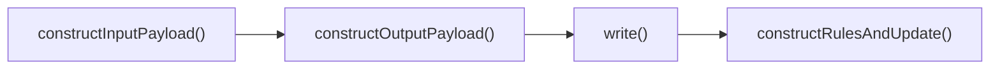
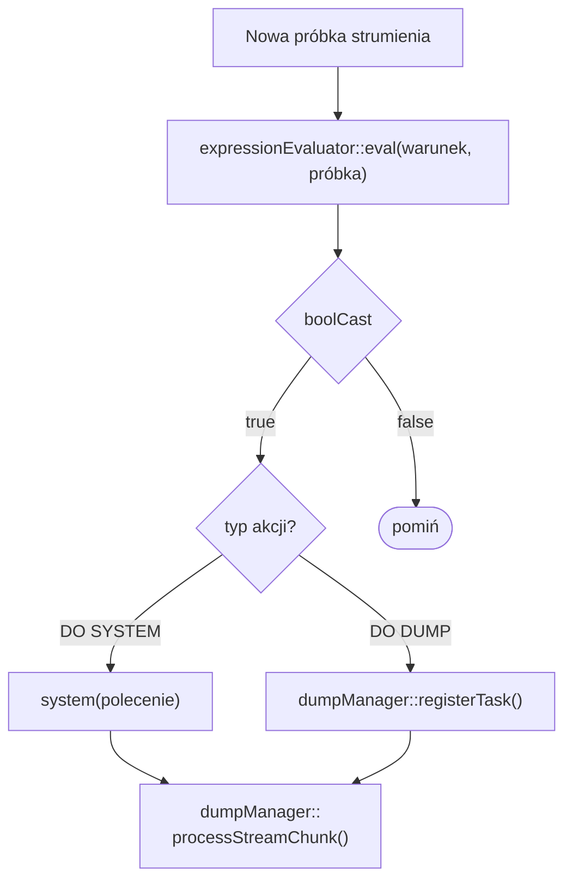
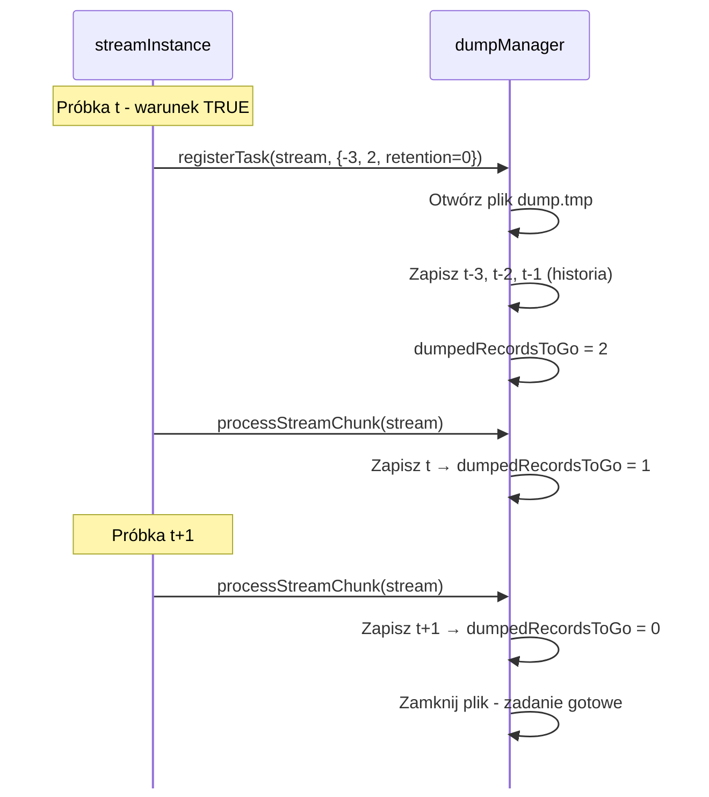
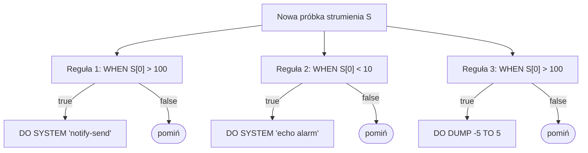

# Realizacja alarmowania

Mechanizm alarmowania (dyrektywa `RULE`) jest nieodłączną częścią głównej pętli przetwarzania. Nie jest osobnym procesem działającym w tle - reguły są ewaluowane **synchronicznie**, w tej samej iteracji siatki czasowej co obliczenia `SELECT`. Daje to pewność, że alarm zawsze odnosi się do danych właśnie obliczonych, a nie z poprzedniego cyklu.

***

## Miejsce RULE w cyklu przetwarzania

Przypomnijmy schemat funkcji `processRows()` opisanej w rozdziale [Algorytm przeglądu drzewa zapytań](algorytm-przegladu-drzewa-zapytan.md). Dla każdego zapytania nie będącego deklaracją wykonywane są kolejno cztery kroki (Rys. 49):



_Rys. 49. Kolejność kroków przetwarzania jednego zapytania_

Krok czwarty - `constructRulesAndUpdate()` - to właśnie wykonanie wszystkich reguł przypiętych do bieżącego zapytania. Wywoływany jest po zapisaniu wyników `SELECT` na dysk, co oznacza, że reguła zawsze ocenia **gotową, właśnie obliczoną próbkę** strumienia.

***

## Ewaluacja warunku WHEN

Każda reguła zawiera listę tokenów opisujących wyrażenie logiczne (pole `condition` struktury `rule`). W momencie ewaluacji system:

1. Pobiera `outputPayload` bieżącego zapytania - to bieżąca próbka strumienia.
2. Przekazuje warunek do silnika `expressionEvaluator::eval()` - **tego samego silnika**, który oblicza wyrażenia `SELECT`.
3. Rzutuje wynik na wartość logiczną (`boolCast`): każda niezerowa wartość liczbowa to `true`, zero to `false`.

Jeśli warunek jest spełniony, wykonywana jest skojarzony z regułą akcja (`DO SYSTEM` lub `DO DUMP`). Jeśli niespełniony - reguła jest pomijana bez żadnych efektów ubocznych. Pełny przepływ przedstawia Rys. 50.



_Rys. 50. Przepływ ewaluacji reguły_

***

## Akcja DO SYSTEM

Wywołanie `DO SYSTEM` jest najprostsze: system wywołuje `::system(polecenie)` bezpośrednio w wątku przetwarzania. Wywołanie jest **synchroniczne** - xretractor czeka na zakończenie procesu przed przejściem do następnej reguły.

Kod wyjścia polecenia jest sprawdzany:
- `0` - sukces, brak wpisu w logu.
- `≠ 0` - xretractor loguje błąd przez spdlog z kodem wyjścia.
- Niepowodzenie `system()` (np. brak powłoki) - logowany jako błąd krytyczny.

> **⚠️ Ostrzeżenie**
>
> Polecenie wykonywane jest synchronicznie. Długo trwające skrypty (np. wysyłanie dużych plików, wywołania sieciowe z timeoutem) opóźnią cały cykl przetwarzania. W takich przypadkach zaleca się uruchamianie procesu w tle: `DO SYSTEM 'mój_skrypt &'`.


***

## Akcja DO DUMP - szczegółowy algorytm

`DO DUMP` zapisuje wskazany zakres rekordów względem próbki `t`, dla której warunek reguły jest prawdziwy. Zakres jest półotwarty: `[step_back, step_forward)`, przy czym `step_back < step_forward`; rekord o przesunięciu `step_forward` nie należy do zrzutu. Ujemne przesunięcia oznaczają historię, `0` próbkę bieżącą, a dodatnie przesunięcia próbki przyszłe. Obsługuje to klasa `dumpManager`.

<div class="timeline compact">

- **Zdarzenie** - warunek `WHEN` prawdziwy dla próbki `t`, reguła wywołuje `dumpManager::registerTask()`
- **Faza 1** - zapis historycznej części zakresu z bufora strumienia (albo ustawienie opóźnienia startu)
- **Faza 2** - jeśli pozostały rekordy do zebrania, `processStreamChunk()` dopisuje próbkę bieżącą i próbki przyszłe
- **Koniec** - przy `dumpedRecordsToGo == 0` najbliższe `processStreamChunk()` zamyka plik i usuwa zadanie bez dopisywania kolejnych rekordów

</div>

### Faza 1: dane historyczne (przy rejestracji zadania)

W chwili wyzwolenia reguły - zaraz po stwierdzeniu, że warunek jest prawdziwy - `dumpManager::registerTask()`:

1. Usuwa istniejący wpis pod nazwą pliku zrzutu (`unlink()`) i tworzy nowy plik przez POSIX `open()` z flagami `O_RDWR | O_CREAT | O_EXCL | O_NOFOLLOW | O_CLOEXEC`. Następnie usuwa z kolejki wcześniejsze zadania piszące pod tę samą nazwę pliku i zamyka ich deskryptory (zob. *Retencja*).
2. Jeśli `step_back < 0`, odczytuje historyczną część zakresu `[step_back, min(step_forward, 0))`, czyli `min(step_forward, 0) - step_back` rekordów. Kompilator uwzględnia najdalsze wymagane przesunięcie historyczne przy wyznaczaniu pojemności strumienia.
3. Zapisuje te rekordy do pliku **od najstarszego do najnowszego**, bez rekordu na prawej granicy zakresu historycznego.
4. Oblicza liczbę pozostałych rekordów: `dumpedRecordsToGo = (step_forward - step_back) - historyWritten`, gdzie `historyWritten` oznacza liczbę rekordów zapisanych w kroku 3, równą zeru przy braku części historycznej.
5. Jeśli `step_back >= 0` (opóźnienie startu), ustawia `delayDumpRecordsToGo = step_back`.

```
Przykład: DUMP -3 TO 2
  Przy rejestracji: zapisz próbki t-3, t-2, t-1 (historia)
  Do zebrania: 2 próbki (t, t+1)
  dumpedRecordsToGo = 2

Przykład: DUMP -5 TO -2
  Przy rejestracji: zapisz próbki t-5, t-4, t-3
  dumpedRecordsToGo = 0 - cały zakres jest już zapisany

Przykład: DUMP -5 TO 0
  Przy rejestracji: zapisz próbki t-5, t-4, t-3, t-2, t-1
  dumpedRecordsToGo = 0 - próbka t nie należy do zakresu
```

Przy `step_forward <= 0` cały zrzut jest gotowy po rejestracji zadania. Najbliższe `processStreamChunk()`, wywoływane jeszcze przy obsłudze próbki `t`, usuwa zakończone zadanie i zamyka jego plik; nie dopisuje próbki bieżącej ani przyszłych.

Dla reguły z pliku planu zakres `DUMP -H TO M` (`H > 0`) wymaga co najmniej `H+1` rekordów: `H` rekordów historii oraz rekordu bieżącego. Kompilator automatycznie powiększa pierścień `STORAGE MEMORY` do tej pojemności, także gdy nie podano `RETENTION` albo jego wartość jest mniejsza. Większe jawne `RETENTION` pozostaje minimum pojemności pierścienia. Dla magazynów plikowych `DEFAULT` i `DIRECT` z ograniczoną retencją kompilator odrzuca plan, jeśli retencja nie zapewnia `H+1` rekordów nawet tuż po rotacji: musi zachodzić `(segments - 1) * capacity + 1 >= H+1`. Dotyczy to również retencji z konfiguracji `[storage] default_retention`.

Dla reguły dołączonej ad hoc historia musi powstać w całości po jej dołączeniu. Przy zakresie `DUMP -H TO M` reguła może po raz pierwszy ocenić warunek `WHEN` na rekordzie `H+1` po dołączeniu: poprzednie `H` rekordów stanowi historię, a nowy rekord jest próbką bieżącą. Bez części historycznej (`H=0`) warunek jest oceniany już dla pierwszego nowego rekordu. Strumień `MEMORY` musi przechowywać co najmniej `H+1` rekordów; żądanie sięgające głębiej jest odrzucane bez dołączenia reguły.

### Faza 2: próbka bieżąca i dane przyszłe

Po rejestracji zadanie trafia do kolejki `bookOfTasks[streamName]`. `dumpManager::processStreamChunk()` jest wywoływane po ocenie wszystkich reguł dla próbki `t`, a następnie po każdej nowej próbce strumienia:

1. Dla każdego aktywnego zadania w kolejce (`dumpedRecordsToGo > 0`):
   - Jeśli `delayDumpRecordsToGo > 0` - dekrementuj i pomiń (opóźnienie startu).
   - Wpp. - zapisz bieżącą próbkę do pliku i dekrementuj `dumpedRecordsToGo`.
2. Gdy `dumpedRecordsToGo` osiągnie 0 - zamknij deskryptor pliku i usuń zadanie z kolejki.

Pełna sekwencja dla `DUMP -3 TO 2` przedstawiona jest na Rys. 51.



_Rys. 51. Sekwencja zbierania danych przez DO DUMP –3 TO 2_

### Przypadek opóźnionego startu (step\_back ≥ 0)

Gdy `step_back` jest nieujemny, zrzut nie zaczyna się od chwili zdarzenia, lecz od `step_back` próbek **po** zdarzeniu:

```
Przykład: DUMP 2 TO 5
  Przy rejestracji: delayDumpRecordsToGo = 2
  Próbka t   → pomiń (delay=2→1)
  Próbka t+1 → pomiń (delay=1→0)
  Próbka t+2 → zapisz (dumpedRecordsToGo = 3→2)
  Próbka t+3 → zapisz (dumpedRecordsToGo = 2→1)
  Próbka t+4 → zapisz (dumpedRecordsToGo = 1→0) - koniec
```

***

## Retencja (RETENTION N)

Bez klauzuli `RETENTION` każde wyzwolenie reguły zapisuje zrzut pod jedną nazwą `<strumień>_<reguła>_dump.tmp`. Z klauzulą `RETENTION N` pierwsze wyzwolenie reguły w danym przebiegu silnika tworzy `_dump_0.tmp`, a kolejne numery plików rotują modulo `N`: `_dump_0.tmp`, `_dump_1.tmp`, …, `_dump_(N-1).tmp`.

Nazwa pliku musi wskazywać jedną regułę. Plan, w którym dwie reguły `DO DUMP` mają ten sam rdzeń `<strumień>_<reguła>` - np. reguła `b_c` na strumieniu `a` i reguła `c` na strumieniu `a_b` - jest odrzucany przy wczytywaniu, a reguła dołączana ad hoc z takim rdzeniem dostaje odmowę. Porównanie nie rozróżnia wielkości liter, bo na systemie plików nieczułym na nią (domyślnie macOS) `Ab_r` i `ab_R` to ten sam plik, a poprawność planu nie może zależeć od hosta. Autor planu zmienia wtedy nazwę reguły albo strumienia.

Plik zrzutu zawsze powstaje od nowa. Silnik kasuje to, co leży pod jego nazwą - także dowiązanie symboliczne albo twarde, za którym nie podąża - i tworzy nowy plik na wyłączność (`O_EXCL | O_NOFOLLOW`). Zapis nie trafia więc do celu dowiązania podstawionego pod końcową nazwę zrzutu. Ta ochrona nie obejmuje podmiany katalogów nadrzędnych podczas rozwiązywania ścieżki; nie jest gwarancją atomowego ograniczenia zapisu do katalogu magazynu. Proces, który trzymał poprzedni zrzut otwarty, nadal widzi jego dawną zawartość. Błąd usunięcia, utworzenia lub pozycjonowania pliku zrzutu jest błędem I/O: `xretractor` kończy wykonanie z klasą środowiska K4 i kodem `EIO` (`5` na Linuksie), podając nazwę pliku i przyczynę. Plik planu usługi pozostaje zachowany; zasady opisuje [xretractor](../zalaczniki/opcje-wywolania/xretractor.md#odmowa-planu-a-awaria-środowiska).

Zadania zrzutu czekają w kolejce `bookOfTasks`, jednej na strumień i wspólnej dla wszystkich jego reguł `DO DUMP`. Kolejka nie ma własnej pojemności i nie wypycha zadań: zadanie kończy się po zebraniu całego zakresu albo wtedy, gdy ta sama reguła odtworzy jego plik. Po utworzeniu nowego pliku `registerTask()` usuwa z kolejki wcześniejsze zadania piszące pod tę samą nazwę, a destruktor `dumpTask` zamyka ich deskryptory. Zastąpione zadanie nie pisze więc do pliku odłączonego od katalogu, a pod każdą nazwą zbiera dane tylko najnowsze wyzwolenie.

Reguła bez `RETENTION` ma zatem w toku najwyżej jedno zadanie i nowe wyzwolenie przerywa jej poprzedni, nieukończony zrzut. Reguła z `RETENTION N` ma najwyżej `N` zadań: nieukończony zrzut przerywa dopiero wyzwolenie, które po zawinięciu numeracji wraca do jego pliku, czyli `N`-te kolejne. Zadania innych reguł na tym samym strumieniu pozostają nietknięte - reguły nie ucinają sobie nawzajem zrzutów, także dwie reguły bez `RETENTION`. Liczba deskryptorów otwartych na strumieniu nie przekracza sumy tych limitów po jego regułach.

Jeśli `step_forward > 0`, ostatnia wymagana próbka ma przesunięcie `step_forward - 1` względem zdarzenia i musi być zapisana przed wyzwoleniem, które ponownie użyje tego samego pliku (przy regularnych zdarzeniach: po `N` interwałach, a bez `RETENTION` po jednym). Dla `step_forward <= 0` cały zrzut zostaje zapisany przy rejestracji.

***

## Format pliku zrzutu

Plik zawiera surowe rekordy binarne bez żadnego nagłówka - każdy rekord ma rozmiar określony przez deskryptor (`descriptor.getSizeInBytes()`). Format jest identyczny z formatem używanym przez artefakty strumienia, co pozwala odczytać go narzędziem `xtrdb` po ręcznym podaniu schematu:

```
$ xtrdb
> storage <ścieżka>
> open <strumień>_<reguła>_dump { <typ> <pole> }
> list
> quit
```

### Pełny zapis rekordu i błędy I/O

Zarówno przy kopiowaniu historii, jak i dopisywaniu bieżących próbek silnik ponawia `write()` do zapisania całego rekordu. Dodatni wynik krótszy od rozmiaru rekordu oznacza postęp, po którym zapisywane są pozostałe bajty. `EINTR` dopuszcza najwyżej pięć kolejnych ponowień; zapisanie kolejnych bajtów zeruje ten licznik. Licznik pozostałych rekordów zadania zmniejsza się dopiero po zapisaniu pełnego rekordu (#479).

Zapis bez postępu (`write()` zwracające `0`) daje `Errc::IO` z `errno=EIO`; inny błąd zapisu zachowuje przyczynę systemową, np. `ENOSPC`, a wyczerpanie ponowień po przerwaniu zachowuje `EINTR`. Komunikat wskazuje ścieżkę oraz liczbę zapisanych bajtów wobec rozmiaru rekordu. `xretractor` kończy taki przebieg błędem środowiska K4 z kodem `EIO` i zachowuje plik planu usługi. Błąd po częściowym zapisie może pozostawić początek rekordu w pliku; zapis nie jest wycofywany. Ukończenie `write()` nie oznacza synchronizacji danych na trwały nośnik. Testy `ut_dumpManager` obejmują zapis w częściach z `EINTR`, brak postępu, `ENOSPC`, limit ponowień oraz błędy pozycjonowania i zapisu historii.

### Kontrakt zrzutu: same wartości, bez NULL i bez przerw

Zrzut jest **bezgłowym blokiem bajtów**. `dumpManager` zapisuje wprost `payload->span()`, rekord po rekordzie, i nie tworzy przy nim żadnego pliku towarzyszącego: nie ma `.desc`, więc schemat trzeba znać z zewnątrz, i nie ma `.meta`, więc mapa `NULL` oraz przerwy w transmisji nie mają gdzie trafić. Rozszerzenie `.tmp` sugeruje plik roboczy, ale to artefakt końcowy - po zamknięciu deskryptora nie następuje żadne przemianowanie.

Wynika z tego jedna konsekwencja, którą trzeba znać przed użyciem zrzutu jako wejścia dla czegokolwiek:

| Co silnik wie o rekordzie | Co widzi czytelnik zrzutu |
| ------------------------- | ------------------------- |
| pole ma wartość `NULL` - z nullfill, z luki transmisji, z przepełnienia arytmetyki, z dzielenia przez zero | wartość zastępcza typu: `0` dla `BYTE`, `INTEGER`, `UINT`, `FLOAT` i `DOUBLE`, `0/1` dla `RATIONAL`, bajty zerowe dla `STRING` |
| przed rekordem była przerwa w transmisji (wpis `gap` w indeksie `.meta`) | nic - rekordy leżą jeden za drugim, bez znacznika |
| rekordu nie ma w ogóle, bo żądane okno sięga głębiej niż zgromadzona historia | rekord wyzerowany, nieodróżnialny od rekordu o wartościach zerowych |

Zero w pliku zrzutu jest więc **nierozróżnialne** od prawdziwego zera, od `NULL` i od rekordu, którego silnik nigdy nie miał. Nie jest to przeoczenie implementacji, lecz granica formatu: `NULL` i przerwa są pojęciami **wnętrza silnika** - żyją w mapie `NULL` payloadu i w indeksie `.meta` towarzyszącym artefaktowi, tam są przechowywane i tam są przetwarzane - a jednolitego sposobu zapisania ich na zewnątrz system na dziś nie ma. Zrzut jest migawką wartości, nie zapisem tego, co silnik wiedział.

Gdy potrzebna jest wierność, informację o braku niosą dwie inne drogi:

* **artefakt strumienia** (`SELECT … STREAM`) wraz ze swoim plikiem `.meta` - `xtrdb` wypisuje mapę `NULL` i przerwy poleceniami `meta` oraz `metaraw` (→ [Pliki](../architektura-systemu-przetwarzania-danych/format-zapisu-danych/pliki.md));
* **kanał klienta** `xqry --jsonl`, w którym brak wartości jest osobnym `null` JSON-owym, per element pola tablicowego (→ [API monitorowania strumieni](../zalaczniki/api-monitorowania-strumieni.md)).

Funkcja `null2zero` w zapytaniu trzecią drogą nie jest: zamienia brak na zero jawnie i w zapytaniu, więc jest konwersją stratną, a nie sposobem eksportu informacji o braku (→ [Operatory agregujące](../konstrukcja-jezyka-zapytan/polecenie-select/operatory-agregujace.md)).

***

## Wiele reguł - kolejność ewaluacji

Do jednego strumienia można przypiąć wiele reguł. Wszystkie ewaluowane są w jednej iteracji `constructRulesAndUpdate()`, w kolejności ich deklaracji w pliku `.rql`. Każda reguła jest niezależna - spełnienie jednej nie wpływa na ewaluację pozostałych (Rys. 52).



_Rys. 52. Niezależna ewaluacja wielu reguł na tym samym strumieniu_

***

## Ograniczenia i uwagi praktyczne

| Sytuacja | Zachowanie |
|---|---|
| Warunek spełniony dwa razy z rzędu (np. pomiar stale powyżej progu) | Każda próbka rejestruje nowe zadanie DUMP; bez RETENTION przerywa ono poprzedni nieukończony zrzut tej samej reguły, z RETENTION N - dopiero `N`-te kolejne wyzwolenie |
| Dwie reguły DUMP o tym samym rdzeniu nazwy pliku (np. `b_c` na `a` i `c` na `a_b`, także różne tylko wielkością liter) | Plan jest odrzucany, reguła ad hoc dostaje odmowę; trzeba zmienić nazwę reguły albo strumienia |
| Strumień wejściowy `DECLARE` jako cel `ON` | Błąd kompilacji - reguły można podpiąć wyłącznie pod `SELECT` |
| Reguła z pliku planu żąda rekordów sprzed początku strumienia | Część historyczna zrzutu nie jest skracana; nieistniejące rekordy są zastępowane zerami |
| Za mało rekordów po dołączeniu reguły ad hoc (`DUMP -H TO M`) | Reguła czeka z oceną `WHEN` na rekord `H+1` po dołączeniu; dla `H=0` ocenia pierwszy nowy rekord |
| Reguła ad hoc z historią `H > 0` na `MEMORY` o pojemności `N <= H` | Żądanie jest odrzucane bez dołączenia reguły; potrzeba `H+1` slotów na historię i rekord bieżący |
| Plik DUMP niedostępny podczas wykonania | Błąd I/O zwrócony przez `Result`; xretractor kończy działanie z kodem `EIO`, zachowując plan usługi. Brak katalogu `STORAGE` przy wcześniejszej kontroli jest odmową planu |
| DO SYSTEM zwraca niezerowy kod | Błąd w logu spdlog; przetwarzanie kontynuuje |
