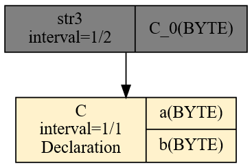
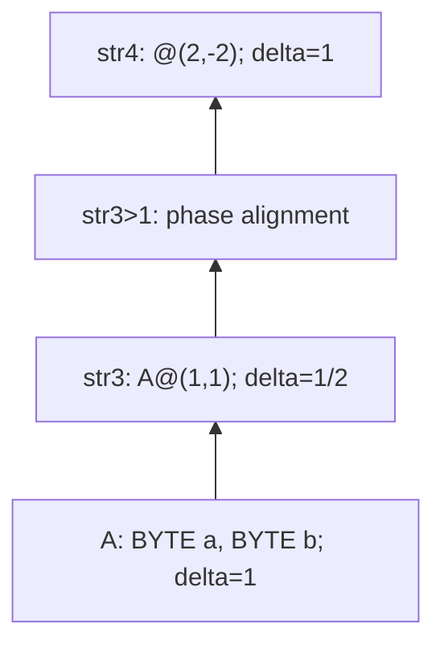

# Przykład serializacji

Na początku stwórzmy plik qplan3.rql o następującej zawartości:

```rql
DECLARE a BYTE, b BYTE STREAM A, 1 TEXTFILE 'data3.txt'
SELECT * STREAM str3 FROM A@(1,1)
```

Oraz  przygotujmy plik data3.txt o następującej zawartości:

```
$ seq 0 9 | paste - -
```

```
0       1
2       3
4       5
6       7
8       9


```

Ostatnia, pusta linia jest istotna i znacząca. Po uruchomieniu xretractor qplan3.rql a w drugim oknie xqry -s str3 ujrzymy coś zbliżonego:

```
$ xqry --null -s str3
7
8
9
0
1
2
3
4
5
6
```

To co widzimy to przykład serializacji. Ciekawy aspekt operatora Agse w tym przypadku widać również w planie realizacji zapytania. Możemy zajrzeć do niego za pomocą polecenia:

```
$ xretractor -c qplan3.rql -f -p -d > out.dot && dot -Tsvg out.dot -o out.svg
```

W pliku out.svg zobaczymy następujący plan realizacji zapytania (Rys. 53):

<figure><figcaption><p>Rys. 53. Plan realizacji zapytania po kompilacji AGSE</p></figcaption></figure>

Ze strumienia źródłowego, w którym co sekundę przychodzą dane zawierające dwa bajty – tworzony jest strumień danych w którym co pół sekundy pojawia się jeden bajt.

Skoro mamy już w systemie strumień danych str3 zwracający sekwencyjne liczby – możemy go wykorzystać do dalszych transformacji. Dodajmy do pliku qplan3.rql następujące zapytanie:

```rql
SELECT * STREAM str4 FROM str3@(2,2)
```

Po uruchomieniu nie ujrzymy jednak oczekiwanej źródłowej postaci pliku dane3.txt. Pojawi się natomiast coś podobnego:

```
$ xqry --null -s str4
2 1
4 3
6 5
8 7
0 9
2 1
4 3
6 5
```

Wynik ma najnowsze pole jako pierwsze, a jego pary obejmują elementy o indeksach 1..2, 3..4 itd. Zmiana znaku szerokości odwraca kolejność pól:

```rql
SELECT * STREAM str4 FROM str3@(2,-2)
```

Pierwsze rekordy takiego strumienia to:

```
$ xqry --null -s str4
1 2
3 4
5 6
7 8
9 0
...
```

Kolejność napływu jest już zachowana, ale para `1 2` nadal łączy pola z dwóch sąsiednich rekordów źródła. Sam minus nie zmienia fazy okna. Aby odtworzyć pierwotne pary `0 1`, `2 3` itd., zastąp ostatnie zapytanie następującym:

```rql
SELECT * STREAM str4 FROM (str3>1)@(2,-2)
```

Przesunięcie `>1` sprawia, że pozycje 1..2 przesuniętego strumienia niosą elementy 0..1 strumienia `str3`. Ujemna szerokość układa je w kolejności napływu. Pierwszy rekord `str4` ma indeks logiczny 1, a kolejne rekordy przywracają wartości i grupowanie źródła:

```
0 1
2 3
4 5
6 7
8 9
...
```

Generując obraz planu zapytania realizujący najpierw serializację a potem deserializację ujrzymy następującą zależność (Rys. 54):



_Rys. 54. Serializacja, wyrównanie fazy i deserializacja_

Zaprezentowano tutaj najbardziej podstawowy przykład zastosowania operatora ruchomego okna danych. Jeśli zaczniemy eksperymentować ze skokiem i rozmiarem okna, zauważymy, że jesteśmy w stanie stworzyć dowolne, przesuwające się okno nad strumieniem danych lub pominąć niektóre elementy budując skok większy od szerokości okna.

<div class="no-print">

Historyczny zapis eksperymentu poniżej pokazuje serializację i odwracanie pól; nie obejmuje dodanego wyżej wyrównania fazy `>1`:

<figure><figcaption><p>Animacja. Zapis sesji eksperymentu z serializatorem AGSE</p></figcaption></figure>

</div>

> **_NOTE:_** Opisana funkcjonalność ma pokrycie w testach: `agse1`, `agse2`, `agse3`, `Pattern6` opisanych w załączniku pt. [Testy Integracyjne](../../zalaczniki/testy-integracyjne.md).

