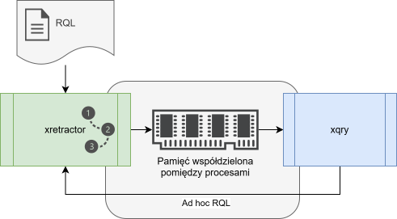

# Zapytania Ad hoc

Przez zapytania Ad hoc rozumiemy zapytania kierowane do działającego systemu. W typowym scenariuszu jaki zakładano w przypadku rozwoju systemu, założono we wstępnie rozpatrywanych scenariuszach, że użytkownik systemu będzie znał wszystkie zapytania i źródła danych wymagane do uzyskania przetworzonych serii czasowych.

W trakcie rozwoju systemu pojawiły się jednak dodatkowe scenariusze, zakładające, że praca systemu nie powinna być przerywana a dodatkowe zapytania powinny zostać dołączone do planu realizacji zapytań. Tego typu funkcjonalność będziemy nazywać zapytaniami Ad hoc, dołączanymi do systemu w trakcie jego działania bez przerywania jego pracy.

<figure><figcaption><p>Rys. 48. Przepływ sterowania dla zapytań Ad Hoc</p></figcaption></figure>

Na Rys. 48 przedstawiono opisany powyżej przepływ sterowania. Plik z zapytaniami i dyrektywami najpierw jest kierowany do procesu xretractor. Następnie poprzez pamięć współdzieloną proces xqry pobiera dane z xretractor. Tym samym procesem możemy wysłać do procesu xretractor polecenie. W tym poleceniu zawieramy tekst dodatkowego zapytania, które xretractor powinien dołączyć do przetwarzanego drzewa.

### Co można dołączyć w locie

Kanałem ad hoc można dołączyć **dokładnie jedno polecenie `SELECT`, `DECLARE` albo `RULE`**. Dyrektywy kompilatora oraz program zawierający kilka poleceń są odrzucane bez zmiany aktywnego planu.

Błąd składni lub niepoprawna wartość jest odsyłana klientowi wraz z powodem, a serwer nadal obsługuje następne polecenia. Parser odrzuca m.in. literały liczbowe poza zakresem, zerowy mianownik, interwał równy zero (w `DECLARE` oraz przy `&`, `%` i `-`) i pustą nazwę `FILE`. Jeśli dołączenie nie powiedzie się po imporcie, serwer przywraca poprzedni plan i wycofuje nowe roszczenia nazw strumieni i plików w magistrali. Tę samą komendę można ponowić po usunięciu przyczyny błędu.

Wycofanie importu obejmuje zarówno błąd zwrócony statusem, jak i wyjątek podczas importu, kompilacji lub rejestracji nowych strumieni. W drugim przypadku klient `xqry -a` wypisuje powód z odpowiedzi serwera, np. `command processor failure: ...`, i kończy się kodem niezerowym. Dotychczasowe strumienie pozostają dostępne, a odrzucone nazwy znikają z planu i magistrali. Obie drogi oraz ponowienie tej samej komendy sprawdza `adhoc_register_rollback`, w tym wariant `-throw`.

Jeżeli muteks magistrali przestanie działać podczas wycofywania importu, plan jest odtwarzany, lecz nowych roszczeń nie da się zwolnić. Pozostają zajęte do końca instancji; dziennik ERROR wymienia nazwy strumieni i ścieżki magazynów wraz z przyczyną. Odmowa importu nie gwarantuje w tym przypadku przywrócenia stanu rejestru magistrali.

Przed dołączeniem nowych strumieni serwer sprawdza katalog `STORAGE`, zachowane deskryptory, istnienie, rodzaj i prawo odczytu źródeł oraz możliwość otwarcia plików wyjściowych oraz odpowiednich `.shadow`. Deskryptor nowego `SELECT` musi zgadzać się z planem w schemacie i nie może wprowadzać `REF`, którego plan nie podaje; jego `TYPE` musi być obsługiwany. Kontrola obejmuje także deskryptory bez `ROTATION` i dla `MEMORY`, ponieważ import ich nie usuwa. Sprawdzane są wyłącznie nowe strumienie. Kontrola otwarcia nie tworzy nowych plików; dla nieistniejącego pliku sprawdza katalog nadrzędny. Odmowa zwraca klientowi przyczynę, np. `cannot open output file`, bez zmiany planu. Jeśli katalog przestanie być dostępny po tej kontroli, błąd otwarcia akcesora POSIX, POSIXSHD lub segmentu DEFAULT/DIRECT również wraca jako odmowa: serwer wycofuje import i nowe roszczenia w magistrali, pozostaje uruchomiony i pozwala ponowić polecenie. Ta obsługa późnego błędu nie obejmuje profilu `STORAGE GENERIC`.

Kolizja wygenerowanej nazwy substratu z innym programem jest odmową kompilacji (`Fail local chain compiler:Substrate name '...' denotes two different programs`), bez zakończenia serwera. Dotyczy także zwykłych nazw z podkreśleniami, takich jak `A_B + C` oraz `A + B_C`. Po odmowie można przesłać poprawione polecenie; kontrole sprawdzają `it_plan_error_e4-run` i `it_storage_refusal-adhoc`.

Nowe źródło można zadeklarować bez zatrzymywania pracującego silnika:

```
$ xqry -a "DECLARE a BYTE STREAM C, 1 TEXTFILE 'data3.txt'"
```

Kod wyjścia `0` bez komunikatu oznacza przyjęcie deklaracji. Deklaracja dołączona po kroku zerowym otrzymuje bazę indeksu logicznego w pierwszym należnym jej slocie. Jeżeli dołączone później zapytanie wymaga okna albo przesunięcia, emisja czeka, aż źródło zgromadzi pełną wymaganą historię. `HOLD` nie jest do tego potrzebny; pozostaje opcjonalną dyrektywą opóźniającą fizyczny odczyt. Ponowne `DECLARE` istniejącej nazwy jest odrzucane, a nie traktowane jako zmiana konfiguracji.

Przy kilku działających instancjach samo `DECLARE` nie wskazuje właściciela, ponieważ nie ma klauzuli `FROM`. Trzeba wtedy podać cel jawnie:

```
$ xqry --server pomiary -a "DECLARE a BYTE STREAM C, 1 TEXTFILE 'data3.txt'"
```

Dołączanie pierwszej deklaracji do serwera uruchomionego z pustym planem nie jest jeszcze obsługiwane; kanał ad hoc wymaga aktywnego modelu danych.

Reguła dołączana w locie może wykonywać `DO DUMP` albo `DO SET`. `DO SYSTEM` pozostaje dostępne tylko w pliku planu, z którego instancja startuje, ponieważ udostępnienie go przez IPC pozwalałoby klientowi wykonywać dowolne polecenia powłoki na koncie serwera. Ta sama granica obowiązuje na kanale `xqry --reset`, który też przenosi pełny plan, ale też nie niesie autorstwa: plan z regułą `DO SYSTEM` jest tam odrzucany w całości, chyba że operator świadomie ustawi `service.unrestricted = true` (→ [xqry](../zalaczniki/opcje-wywolania/xqry.md#reguła-do-system-nie-przechodzi-tym-kanałem)). Kanał ad hoc odmawia bezwarunkowo i tego klucza nie czyta. Cel `ON` musi być istniejącym strumieniem utworzonym przez `SELECT`.

Przy historycznym zakresie `DUMP -H TO M` warunek `WHEN` jest oceniany najwcześniej na rekordzie `H+1` po dołączeniu, gdy `H` poprzednich rekordów również pochodzi już z tego okresu. Dla zakresu bez historii (`H=0`) ocena zaczyna się od pierwszego nowego rekordu. Magazyn `MEMORY` musi mieć co najmniej `H+1` slotów; przy `H > 0` i pojemności `N <= H` żądanie jest odrzucane bez dołączenia reguły. Dołączenie nie zwiększa pojemności istniejącego magazynu. Szczegóły opisuje [Realizacja alarmowania](realizacja-alarowania.md#faza-1-dane-historyczne-przy-rejestracji-zadania).

```bash
xqry --server pomiary -a \
  "RULE alarm ON temperatura WHEN temperatura[0] > 80 DO DUMP -10 TO 5"
```

Na strumieniu `MEMORY` powyższy przykład wymaga co najmniej 11 slotów; przy pojemności 10 żądanie jest odrzucane.

Przy wielu instancjach klient kieruje `SELECT` według właścicieli strumieni z `FROM`, a `RULE` według strumienia z `ON`. Zapytanie łączące źródła z kilku serwerów jest odrzucane. Nowe nazwy strumieni i pliki magazynu są zgłaszane w magistrali przed modyfikacją aktywnego planu, więc ad hoc nie może nadpisać zasobu innej instancji.

Ad hoc powiększa istniejący plan. Do jego pełnego, atomowego zastąpienia - także w instancji bezczynnej - służy `xqry --reset plik.rql`.

### Zmienne planu i DO SET

Ad hoc widzi zmienne `VAR` aktywnego planu: może je czytać w `SELECT` i `WHEN` oraz zapisywać przez dołączoną regułę `DO SET`. Deklaracje `VAR` i `LET` są odrzucane; stałe `LET` z pliku planu nie są widoczne. Dla planu z przykładu [histerezy](../konstrukcja-jezyka-zapytan/polecenie-var.md#histereza) można wysłać:

```bash
xqry --server pomiary -a "SELECT status[0], ?ALARM STREAM monitor FROM status"
xqry --server pomiary -a "RULE force_alarm ON status WHEN status[0] >= 300 DO SET ?ALARM = 1"
```

Reguła zaczyna oceniać warunek od następnego nowego rekordu celu. Jej zapis jest zatwierdzany na końcu slotu, więc staje się widoczny od kolejnego slotu. W konflikcie z regułą planu albo wcześniej dołączoną regułą ad hoc wygrywa później dołączona wyzwolona reguła. Nie ma osobnego klucza konfiguracji dla `SET`; odmowa `DO SYSTEM` pozostaje bez zmian.

Typ prawej strony musi być typem zmiennej. Odmowa nie zmienia wartości ani reguł aktywnego planu. Przyjęte ad hoc zachowuje stan istniejących zmiennych; przyjęty `--reset` tworzy nowy stan z deklaracji i usuwa reguły ad hoc poprzedniego planu. Reguła `SET` może wskazać istniejącą pojedynczą instancję generatora, np. `cell$0`; cała rodzina nie jest celem w żywym planie. Pokrycie: `it_var_adhoc-run`.

### Kiedy zaczyna się strumień dołożony ad hoc

Plan zbudowany od początku pracy systemu numeruje rekordy od początku logicznego wyliczonego przez kompilator. Zapytanie dołożone po kroku zerowym nie ma takiej przeszłości - jego baza odpowiada **pierwszemu należnemu slotowi, w którym runtime je obsłużył**, a nie slotowi zerowemu planu. Import jest atomowy: skompilowane drzewo i jego instancje strumieni są publikowane pod wspólnym zamkiem, a pętla wykonania przebudowuje siatkę czasu bez cofania się, nawet jeśli nowe zapytanie wnosi nowe tempo.

Model może przyjmować komendy jeszcze przed krokiem zerowym, np. przy bramce `--xqrywait` (`-x`). Źródło plikowe dołączone w tym oknie należy do początkowego planu epoki: krok zerowy nadaje mu bazę wyliczoną przez kompilator i przygotowuje pierwszy rekord, tak samo jak źródłom z pliku planu. Źródła `DEVICE` nie mają odczytu w kroku zerowym; ich pierwszy rekord jest czytany w należnym slocie. W trakcie samego kroku zerowego wspólny zamek blokuje import do zakończenia inicjalizacji. Przypadek dołączenia źródła przed tym krokiem sprawdza `it_hash_string-adhoc-zero-step`.

> **_NOTE:_** Zachowanie to ma pokrycie w teście `issue227_join_alignment` (przypadek `adhoc-origin`).

### Przykład

Przykład rozpoczniemy od przygotowania prostego zapytania:

```rql
DECLARE a BYTE STREAM A, 1 TEXTFILE 'data1.txt'
DECLARE a BYTE STREAM B, 2 TEXTFILE 'data2.txt'
SELECT * STREAM str1 FROM A+B
```

Plik z zapytaniem zapiszemy pod nazwą qplan1.rql. Do poprawnej realizacji zapytania konieczne jest również przygotowanie plików data1.txt i data2.txt. Proponuję wypełnić data1.txt kolejnymi liczbami od 1 do 6 każda w nowej linii, a w pliku data2.txt liczby od 10 do 15. W tak przygotowanym katalogu uruchamiamy polecenie

```
$ xretractor qplan1.rql
```

Bez `ROTATION` start usuwa wcześniejsze pliki wyników `SELECT`, więc dawny schemat `str1` nie blokuje tego przykładu. Przy zachowaniu plików przez `ROTATION` niezgodny deskryptor jest odmową przed startem z komunikatem `descriptor schema mismatch` i ścieżką pliku. Operator musi przywrócić zgodny plan albo świadomie usunąć rodzinę plików strumienia i rozpocząć go od nowa. Import ad hoc zachowuje istniejące pliki i również odrzuca niezgodny deskryptor.

Proces xretractor rozpocznie przetwarzanie danych. Należy w tym momencie uruchomić kolejny terminal i wydać w nim polecenie:

```
$ xqry -d
name | duration | size | count | location  | cap
-----+----------+------+-------+-----------+----
str1 | 1        | 48   | 24    |           | 0
A    | 1        | -1   | 3     | data1.txt | 1
B    | 2        | -1   | 2     | data2.txt | 1
```

W postaci tabelarycznej wyświetli się co w danym systemie się przetwarza. Ile bajtów już napłynęło, z jakich plików dane są czytane. Ile danych zostało już przetworzonych. Oczekując bardziej opisowej formy możemy wydać następujące polecenie:

```
$ xqry -d -y
---
apiVersion: xqry/v1
streams:
  - name: str1
    delta: 1
    size: 214
    count: 107
  - name: A
    delta: 1
    count: 86
    location: data1.txt
  - name: B
    delta: 2
    count: 43
    location: data2.txt
```

Udzielona odpowiedź jest w formie yaml.

Aby dołożyć do systemu kolejne zapytanie musimy wydać polecenie:

```
$ xqry -a "SELECT * STREAM str2 FROM A#B"
```

Polecenie w tej formie wysyła do procesu xretractor nowe zapytanie. Brak komunikatu i kod wyjścia `0` oznaczają przyjęcie. System otrzymując je prowadzi kompilację i złączy drzewa planów zapytań; przy odmowie `xqry` zwraca kod niezerowy i zapisuje przyczynę diagnostyczną.

Jeśli zajrzymy ponownie do stanu systemu, zobaczymy następujący obraz:

```
$ xqry -d
name | duration | size | count | location  | cap
-----+----------+------+-------+-----------+----
str2 | 2/3      | 10   | 10    |           | 0
A    | 1        | -1   | 23    | data1.txt | 1
str1 | 1        | 312  | 156   |           | 0
B    | 2        | -1   | 12    | data2.txt | 1
```

Lub tak:

```
$ xqry -d -y
---
apiVersion: xqry/v1
streams:
  - name: str2
    delta: 2/3
    size: 7
    count: 7
  - name: A
    delta: 1
    count: 16
    location: data1.txt
  - name: str1
    delta: 1
    size: 298
    count: 149
  - name: B
    delta: 2
    count: 8
    location: data2.txt
```

Przyglądając się dokładniej zapytaniom za pomocą polecenia xqry zobaczymy następującą odpowiedź systemu dla zapytania str1:

```
$ xqry -t str1 -y
---
apiVersion: xqry/v1
stream:
  name: str1
  delta: 1
query: SELECT * STREAM str1 FROM A+B
fields:
  str1.A_0:
    type: BYTE
  str1.B_1:
    type: BYTE
```

oraz dla zapytania str2:

```
$ xqry -t str2 -y
---
apiVersion: xqry/v1
stream:
  name: str2
  delta: 2/3
query: SELECT * STREAM str2 FROM A#B
fields:
  str2.a:
    type: BYTE
```

Jak widać dodatkowe zapytanie str2 zostało poprawnie złączone z istniejącym planem realizacji zapytania. Widać też że zebranych danych jest o wiele mniej w porównaniu z str1.

> **_NOTE:_** Opisana funkcjonalność ma pokrycie w teście: `issue6_adhoc` opisanym w załączniku pt. [Testy Integracyjne](../zalaczniki/testy-integracyjne.md).
